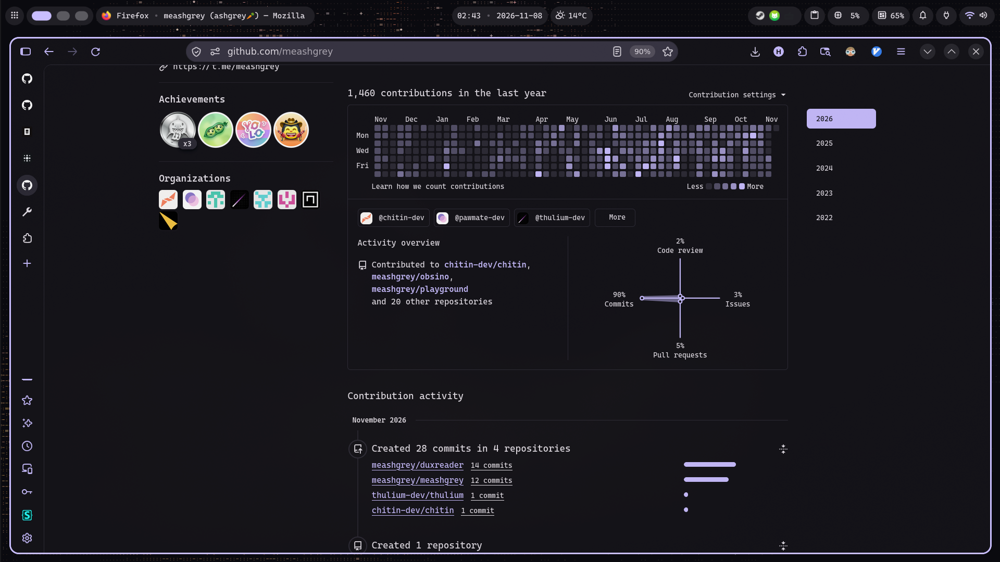
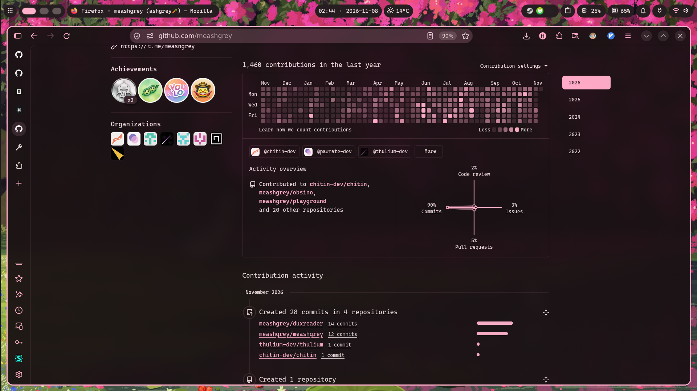
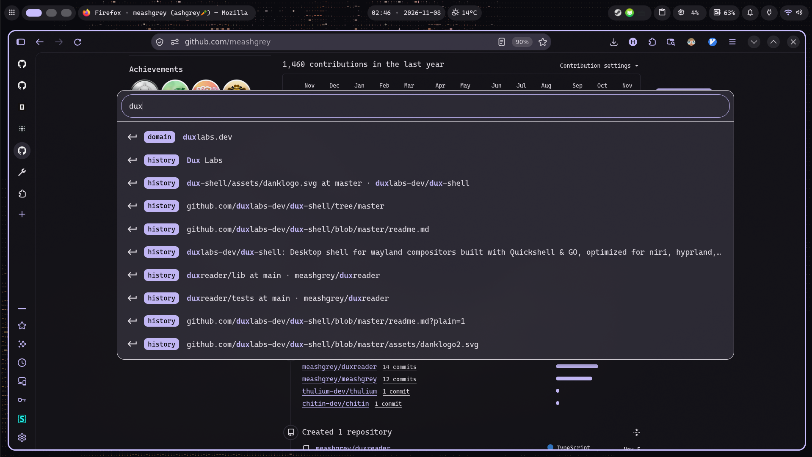
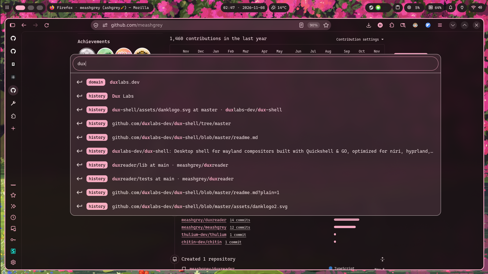

# duxreader

<p align="center" name="markdown">
  
</p>

Bring your desktop palette to web pages. Built with WXT, React, Material Design 3, and a Rust file-watching bridge.

|                             Purple                              |                            Pink                             |
| :-------------------------------------------------------------: | :---------------------------------------------------------: |
|    |    |
|  |  |

- 📦 **Per-site control.** The popup can exclude individual sites by hostname; excluded sites keep their original colors.
- 🎯 **Element picker.** Preserve or map the colors of a selected element, then copy the resulting per-site
  rules for source-level site fixes.
- 🧩 **Component-aware selectors.** Generated class names are collapsed to component families, and stable
  data attributes, route prefixes, or structural families are preferred over instance paths.
- 👁️ **Preview before saving.** The picker shows how many elements a rule affects. Overlapping boxes can be
  stepped through with the **arrow keys** before clicking, and elements inside open shadow roots can be
  picked like ordinary DOM nodes.
- ✏️ **Editable, portable rules.** Saved rules can be re-targeted to another theme role, removed with a short
  undo window, and copied for source-level fixes.
- ⌨️ **Keyboard shortcuts.** `Alt+Shift+E` starts a preserve pick and `Alt+Shift+M` a map pick without
  opening the popup.
- 💾 **Rule overview and backups.** Preferences lists every rule grouped by site and can export or import
  them as JSON.

## 📦 Install

Download [0.1.1 test packages](https://github.com/meashgrey/duxreader/releases/tag/v0.1.1) for Firefox and Chromium/Edge. See [installation instructions](docs/INSTALL.md). Firefox's unsigned test package requires temporary loading.

## 🛠️ Development

```sh
git submodule update --init --recursive
nix develop path:.
bun install --frozen-lockfile
bun run dev
```

For Chrome/Chromium, use `bun run dev`. For Firefox, use `bun run dev:firefox`, open `about:debugging`, and load `.output/firefox-mv2-dev/manifest.json` as a temporary add-on. Pin Duxreader to the toolbar.

## 🌈 Theme sources

- **Pywalfox** (Firefox): follow the active browser theme. No Duxreader bridge required.
- **Theme file**: watch Matugen JSON output. See the [template](examples/matugen/duxreader.json) and [configuration](examples/matugen/config.toml).

For file mode on Linux:

```sh
bun run build:bridge
bun run prepare:bridge
bun run install:bridge
```

Reload the extension, then select **Choose file**. The native chooser requires a working desktop portal. Chrome registration also needs `--chrome-id YOUR_EXTENSION_ID` during preparation and `--browser chrome` during installation.

## ⌨️ Vimium

Upstream [Vimium](https://github.com/philc/vimium) is vendored at `vendor/vimium`
and bundled into Duxreader by default. Its normal-mode key bindings and commands are
unchanged. The Vomnibar, HUD, and help dialog are React and Material 3 components in
`entrypoints/`; they follow the same desktop palette as the rest of Duxreader. Upstream
options and command-listing pages inherit the palette through a shared page theme.

After checking out or updating the submodule, regenerate the bundled assets:

```sh
git submodule update --init --recursive
bun run vimium:build
```

## ✅ Checks and builds

```sh
bun run check
bun run test:browser # Requires Firefox
bun run test:sites # Live websites preserve and color map tests; requires Chromium and network
bun run test:vimium # Vimium shortcuts and palette in the production extension; requires Chromium
bun run benchmark:interaction # Requires a production build and Chromium
bun run build
bun run build:firefox
```

The pinned Dark Reader dynamic engine maps page colors to the Pywalfox/Matugen palette. Custom CSS remains supported. See [engine notes](scripts/engine/README.md).

Performance measurements and reproduction commands: [benchmarks](docs/performance.md).
